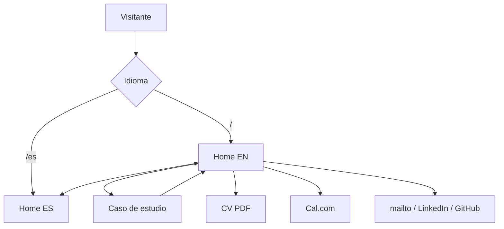

# Flujo de app

## Rutas
| Ruta EN | Ruta ES | Contenido |
| --- | --- | --- |
| `/` | `/es/` | Home (bento) |
| `/projects/<slug>/` | `/es/proyectos/<slug>/` | Caso de estudio |
| `/privacy/` | `/es/privacidad/` | Privacidad |
| `/404` | — | No encontrado (bilingüe) |

## Pantallas
- **Encabezado (todas)**: nombre/logo → home del idioma actual · selector EN/ES → misma página en el otro idioma · botón tema → alterna claro/oscuro.
- **Home (bento)**, en orden de lectura (= orden del DOM):
  1. Hero: nombre, rol, subtítulo, disponibilidad · CTA "Ver mi trabajo" → ancla a proyectos · CTA "Descargar CV" → PDF del idioma · CTA "Agendar llamada" → Cal.com (nueva pestaña).
  2. Foto + ubicación.
  3. Ahora (si la fecha tiene ≤ 90 días).
  4. Proyecto 1, Proyecto 2 (… hasta 5): tarjeta con problema en una línea, rol, stack · → página de caso (con View Transition).
  5. Experiencia: Mirus, INSTALAAB · → LinkedIn (nueva pestaña).
  6. Cómo pienso.
  7. Skills: uso diario + "también he trabajado con" · aprendiendo · business skills.
  8. Contacto: correo (`mailto`), LinkedIn, GitHub, Cal.com, CV, idiomas.
- **Caso de estudio**: volver → home#proyectos · Problema → Acción → Resultado · decisiones técnicas · rol · media · enlaces a demo y repo (si existen) · siguiente proyecto.
- **Privacidad**: qué no se recoge (sin formularios ni cookies), analítica usada, contacto.
- **Pie (todas)**: enlace a privacidad, repo del portafolio, año.

## Bento de la home (borrador, se ajusta en Fase 3)
Escritorio, 4 columnas:
```
+---------------------------+---------------------------+
| HERO (2x2)                | FOTO + UBICACIÓN (2x1)    |
| rol + subtítulo + CTAs    +---------------------------+
|                           | AHORA (2x1)               |
+---------------------------+---------------------------+
| PROYECTO 1 (2x2)          | PROYECTO 2 (2x2)          |
+---------------------------+---------------------------+
| EXPERIENCIA (2x1)         | CÓMO PIENSO (2x1)         |
+---------------------------+---------------------------+
| SKILLS: uso diario (2x1)  | APRENDIENDO | BUSINESS    |
+---------------------------+-------------+-------------+
| CONTACTO (4x1)                                        |
+-------------------------------------------------------+
```
El orden visual coincide con el del DOM. Con 3–5 proyectos: P1 2x2, el resto 2x1 o 1x1. Si "Ahora" está vencido, la foto ocupa 2x2. Móvil: una columna en el mismo orden.

## Estados
- "Ahora" vencido → la celda no se renderiza y el grid se reacomoda.
- Contenido con `[PENDIENTE]` → visible en desarrollo; el build de producción falla.
- Imagen o video que no carga → texto alternativo y póster.
- Sin JS → todo funciona salvo el botón de tema (se sigue el sistema).
- `prefers-reduced-motion` → sin transiciones ni animaciones.

## Diagrama

